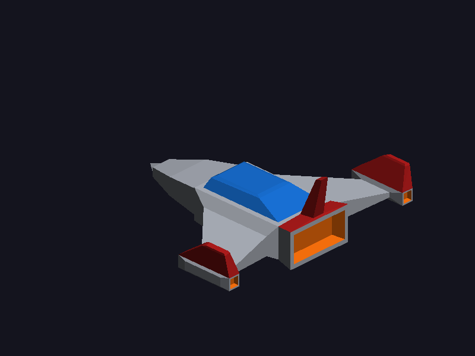

# lab3graficas

Nave espacial simple modelada a partir de un único cubo, exportada como OBJ triangulado y dibujada en pantalla con un renderer por software. Todo está hecho en Rust.



## Entrega

| Archivo | Descripción |
| --- | --- |
| `nave.obj` | Modelo triangulado (262 triángulos, 133 vértices) con coordenadas UV y normales |
| `nave.mtl` | Materiales con color base simple |
| `nave.gif` | Animación de la nave girando |

## Modelado

La nave parte de un cubo y no se agrega ningún otro objeto. Las herramientas están implementadas en `src/mesh.rs` y la nave se arma en `src/nave.rs`:

- **Scale**: proporciones del casco, alas, góndolas y aletas
- **Move**: barrido de las alas hacia atrás y punta de la nariz
- **Rotate**: inclinación hacia afuera de las aletas de las alas
- **Extrude**: nariz, alas, góndolas, aletas, cabina y toberas
- **Inset**: borde de la cabina y de las toberas
- **Bevel**: bordes de la cabina
- **Subdivide**: punta de la nariz

Materiales (solo color base): Casco gris, Cabina azul, Motor naranja y Detalle rojo.

Al exportar, cada cara se triangula y se escriben coordenadas UV y normales; no se exportan colores por vértice ni curvas.

## Render

El programa lee `nave.obj` y `nave.mtl`, transforma los vértices con matrices de `nalgebra-glm` y rasteriza los triángulos con coordenadas baricéntricas en un framebuffer propio con z-buffer, que se muestra con `minifb`. Cada cara usa el color de su material con iluminación plana según su normal.

## Ejecutar

```bash
cargo run --release
```

Otros modos:

```bash
cargo run --release -- --exportar
```

```bash
cargo run --release -- --gif
```

```bash
cargo run --release -- --captura
```

`--exportar` vuelve a generar `nave.obj` y `nave.mtl` desde el cubo, `--gif` genera `nave.gif` y `--captura` guarda `captura.bmp` (se puede combinar con `--wireframe`).

## Controles

| Tecla | Acción |
| --- | --- |
| Flechas | Rotar la nave |
| W / S | Acercar / alejar |
| Espacio | Alternar relleno y wireframe |
| R | Activar / detener giro automático |
| P | Guardar `captura.bmp` |
| Esc | Salir |

## Estructura

| Archivo | Contenido |
| --- | --- |
| `src/main.rs` | Ventana, cámara, controles y modos de ejecución |
| `src/mesh.rs` | Malla, cubo inicial y herramientas de modelado |
| `src/nave.rs` | Construcción de la nave y materiales |
| `src/exportar.rs` | Escritura de `nave.obj` y `nave.mtl` triangulados |
| `src/obj.rs` | Carga de `.obj` y `.mtl` |
| `src/triangle.rs` | Líneas (Bresenham) y rasterizado de triángulos |
| `src/framebuffer.rs` | Framebuffer con z-buffer |
| `src/bmp.rs` | Capturas en BMP |
| `src/animacion.rs` | Generación del GIF |

## Pruebas

```bash
cargo test --release
```

Verifican que la malla quede cerrada, que las extrusiones vayan en la dirección correcta y que no haya triángulos degenerados.
